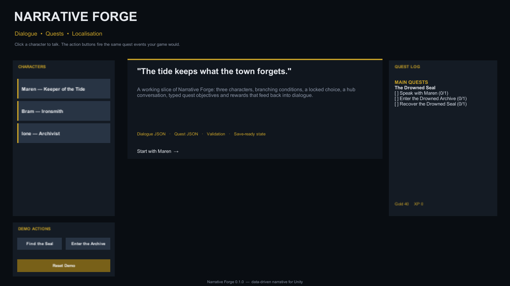

# Harbour Demo

The Harbour Demo is the packaged sample. It shows branching dialogue, a live
quest log, conditional starts, locked choices, reward flags, localisation and a
second quest unlocked by the first.

## Import and run

1. Open **Window → Package Manager**.
2. Select **Narrative Forge**.
3. Open **Samples** and import **Harbour Demo**.
4. Open `Scenes/NarrativeForgeDemo.unity`.
5. Press Play.

The sample is copied to `Assets/Samples/Narrative Forge/…`, so you can edit it
without changing the package.

## What is in the scene

| Character | Role |
|---|---|
| Maren, Keeper of the Tide | Starts the main quest and explains the Drowned Seal |
| Bram, Ironsmith | Sells the iron key and reacts to the seal |
| Ione, Archivist | Provides lore about the archive |

| Quest | Type | Objectives |
|---|---|---|
| The Drowned Seal | Main | Talk to Maren, reach the archive, recover the seal |
| Iron for the Road | Side | Buy the iron key, tell Bram the key fits |

The demo starts with **40 gold** and **0 XP**, and starts **The Drowned Seal**
automatically.

## Try the flow

### 1. Talk to Maren

Click **Maren** in the character column. The dialogue panel opens. Choose
**Tell me about the Drowned Seal** and then **I'll find the seal.**

Talking advances the `talk` objective. The reply also sets
`seal_quest_accepted`.

### 2. Visit the archive

Click **Enter the Archive** in the demo actions column. This calls:

```csharp
narrative.Quests.OnReach("drowned_archive");
```

In a real game, the same call would come from a trigger volume.

### 3. Find the seal

Click **Find the Seal**. This calls:

```csharp
narrative.Quests.OnCollect("seal");
```

When all three objectives are complete, quest 1 completes:

- `seal_found` is set;
- 50 gold and 100 XP are added;
- quest 2, **Iron for the Road**, starts;
- Maren, Bram and Ione all have new conditional dialogue.

### 4. Buy the key from Bram

Talk to **Bram**. The key choice is gated by `var:gold:>=:25` and shows the
`Need 25 gold` hint when it is unavailable.

Choose **A key for the drowned archive**, then **Take the gold.** The demo
bridges the purchase choice to `OnCollect("iron_key")` and deducts 25 gold in
the reply node.

### 5. Finish the side quest

Talk to Bram again after buying the key. The second objective completes and
**Iron for the Road** rewards 20 gold, 50 XP and `iron_quest_done`.

### 6. Reset

Click **Reset Demo** to clear dialogue and quest state, restore the starting
gold and restart quest 1. This is a sample convenience, not a runtime feature.

## Screens



The idle screen shows the character column, quest log, demo actions and the
intro card.


The dialogue panel shows the speaker, body text, choices and a locked choice
with its hint.

## How the sample is wired

`DemoBootstrap` is sample code, not part of the runtime API. It:

- loads `loc_en.json` into a `LocalizationTable`;
- starts quest 1 and seeds the gold/XP variables;
- forwards character button clicks to `Dialogue.Start(npcId)`;
- maps the action buttons to `OnCollect` and `OnReach`;
- bridges the key purchase choice to the `iron_key` collect objective;
- starts quest 2 when quest 1 completes;
- applies reward flags, gold and XP through a custom `RewardSink`.

Use it as a reference for your own integration, then replace it with your game's
interaction, inventory and quest UI.

## Sample data

The sample data lives next to the scene:

```text
Data/
├── dialogues.json
├── quests.json
└── loc_en.json
```

Edit these files to experiment. The dialogue and quest databases validate on
load and print warnings to the Console.
