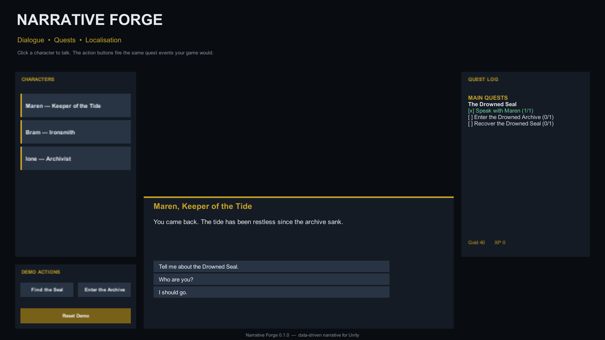

# Narrative Forge

Dialogue · Quests · Localisation

Narrative Forge is a data-driven narrative toolkit for Unity. Write branching
conversations, conditional choices and typed quests in JSON; keep the runtime
small, testable and independent of your gameplay code.

Unity 6000.6+
uGUI included
Built-in · URP · HDRP
Input System optional
No third-party runtime dependencies

<figure class="hero" markdown>

<figcaption>The Harbour Demo: branching dialogue, a live quest log and reward-driven flags.</figcaption>
</figure>

## What you get

-   :material-message-text-outline:{ .lg .middle } **Branching dialogue**

    ---

    NPCs, conditional entry points, hubs, locked choices, flags, variables and
    per-choice conditions — all authored in readable JSON.

-   :material-clipboard-check-outline:{ .lg .middle } **Typed quests**

    ---

    Talk, kill, collect, reach, discover and dungeon-boss objectives. Quests
    complete automatically when every objective is satisfied.

-   :material-account-voice:{ .lg .middle } **Conditions that connect systems**

    ---

    Dialogue can check flags, prior choices, NPCs met, integer variables and
    quest state. Quest rewards can set the flags that unlock later dialogue.

-   :material-translate:{ .lg .middle } **Localisation**

    ---

    A small nested-JSON table with dot keys and `{token}` formatting for UI
    strings, plus per-language dialogue and quest files.

-   :material-content-save-outline:{ .lg .middle } **Save and load**

    ---

    Serialisable dialogue and quest state, including flags, variables, responses,
    met NPCs, seen nodes and objective progress.

-   :material-check-decagram-outline:{ .lg .middle } **Validation**

    ---

    Duplicate IDs, broken links, unreachable nodes, missing flags, bad
    prerequisites and unusable objectives are reported before they become bugs.

## How it works

1. **Author** dialogue and quests as JSON assets.
2. **Add** `NarrativeForgeBehaviour` to a scene object and assign the assets.
3. **Present** the conversation with `DialogueView` and the journal with
   `QuestLogView`, or drive your own UI from the runtime events.

The core (`DialogueRunner`, `QuestSystem`, `LocalisationTable`) has no Unity
dependency, so it can run in edit-mode tests, a build pipeline or a different
front end.

## Requirements

| Requirement | Notes |
|---|---|
| Unity | 6000.6 or newer; tested with 6000.6.6f1 |
| UI | uGUI (`com.unity.ugui`), installed as a package dependency |
| Input | Input System optional; the sample adapts at runtime |
| Render pipeline | No dependency; works with Built-in, URP and HDRP |

## Start here

-   **New to Narrative Forge?**

    Start with [Installation](getting-started/installation.md), then follow the
    [Quick start](getting-started/quick-start.md).

-   **Wiring a scene?**

    See [Scene setup](getting-started/scene-setup.md) for the component and
    hierarchy reference.

-   **Looking for a format?**

    Jump to the [Dialogue JSON reference](dialogue/json-reference.md) or the
    [Quest JSON reference](quests/json-reference.md).

-   **Something is not working?**

    Check [Validation](validation.md) and [Troubleshooting](troubleshooting.md).

## Support

Narrative Forge is published by **camenduru**.

- Email: [unity@camenduru.com](mailto:unity@camenduru.com)
- Website: [camenduru.com](https://camenduru.com)
- Documentation issues: [open an issue](https://github.com/camenduru/NarrativeForgeDoc/issues)
